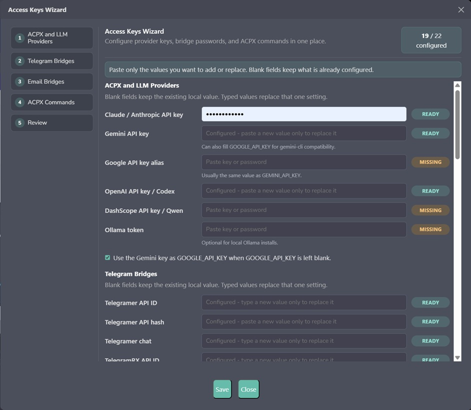

<!--
═══════════════════════════════════════════════════════════════════
  ✦  T L A M A T I N I  ✦   —   "one who knows"
  Created by  Angela López Mendoza   ·   @angelahack1
  Developer · Architect · Creator of Tlamatini
  Tlamatini Author Banner — do not remove (Angela's name is kept in every build)
═══════════════════════════════════════════════════════════════════
-->

<p align="center">
  
</p>

<h1 align="center">Tus ideas merecen más que una ventana de chat.</h1>

<p align="center">
  <b>Crea software. Da forma a mundos 3D. Dale vida al hardware.</b><br />
  Tlamatini es un entorno local-first de desarrollo y automatización con IA para Windows.<br />
  Platica con ella, trabaja a su lado en el editor y conecta agents especializados en workflows visuales.
</p>

<p align="center">
  <a href="https://github.com/XAIHT/Tlamatini/releases/latest"></a>
  <a href="#installation"></a>
  <a href="LICENSE"></a>
  <a href="https://discord.gg/WFQsrskgc"></a>
</p>

<p align="center">
  <a href="https://www.youtube.com/watch?v=4MyRXBahHuU&t=41s"><b>▶ Ver el teaser</b></a> ·
  <a href="https://xaiht.org">Sitio web</a> ·
  <a href="BookOfTlamatini.md">Guía completa</a> ·
  <a href="Tlamatini-Architecture.pdf">Atlas de arquitectura</a> ·
  <a href="docs/changes/2026-10-22-v1.90.0.md">Novedades</a>
</p>

> > [!IMPORTANT]
> **EL PODER COMPLETO EMPIEZA CON OLLAMA PRO.** Una **suscripción Ollama Pro o superior** activa es un prerrequisito para la experiencia completa que Tlamatini busca ofrecer. Tlamatini en sí es **gratis y de código abierto**; la suscripción de Ollama es una compra aparte que se hace directamente con [Ollama](https://ollama.com/pricing). Las ejecuciones largas de agents, los contextos grandes de proyecto, las llamadas repetidas a tools y el trabajo de visión en paralelo necesitan una capacidad de nube considerable. Pro es el nivel mínimo previsto; las cargas de trabajo más pesadas pueden necesitar más capacidad. [Entiende los requisitos →](#requirements)

<p align="center">
  <b>86 workflow agents</b> &nbsp;·&nbsp; <b>67 agents que puedes llamar desde el chat</b> &nbsp;·&nbsp; <b>110 tools integrados</b><br />
  <sub>Inventario del código fuente actual v1.90.0. Los 67 wrappers de chat están incluidos en los 110 tools; los servidores External MCP activados agregan sus propios tools.</sub>
</p>

<p align="center">
  <a href="#las-joyas-de-la-corona">Explorar</a> ·
  <a href="#edita-aprende-ejecuta">Editar · Aprender · Ejecutar</a> ·
  <a href="#habla-y-escucha">Voz</a> ·
  <a href="#workflows-visuales">Workflows</a> ·
  <a href="#instalación">Empezar</a> ·
  <a href="#documentación">Profundizar</a>
</p>

---

## Las joyas de la corona

**La parte interesante empieza cuando una idea llega al mundo fuera del editor.** Tlamatini reúne el código, los motores creativos y los dispositivos conectados en un solo espacio de trabajo, con agents que puedes configurar, combinar e inspeccionar.

| Construye tu mundo | Lo que Tlamatini trae a la mesa de trabajo |
| :--- | :--- |
| 🎮 **Unreal Engine · Unrealer** | Trabaja con tu entorno de Unreal Engine desde el chat. Lleva las operaciones del motor a la misma conversación que tu código y las tareas del proyecto. |
| 🎬 **Blender · Blenderer** | Trabaja con escenas, objetos, rendering y Python a través de una integración conectada de Blender MCP. Convierte las operaciones creativas en pasos de un workflow más grande. |
| ⚡ **STM32 · STM32er** | Compila firmware, flashea una board conectada y revisa el output serial con los backends de STM32 soportados, con un preflight que revisa el target antes de flashear. |
| 📡 **ESP32 · ESP32er** | Empieza desde el template de blink-and-print incluido, elige tu board y luego compila, flashea y monitorea con PlatformIO. Pasa de la idea de un proyecto a un dispositivo que puedes observar. |

**Arduino y ESPHome también se suman a la mesa.** Arduiner trabaja a través de `arduino-cli`; ESPHomer crea y administra las configuraciones de dispositivos de ESPHome. Cada integración necesita su aplicación, toolchain, hardware o servicio compatible. El [catálogo de agents](agents_descriptions.md) explica qué hace cada especialista.

## Edita, aprende, ejecuta

El desarrollo más reciente acerca a Tlamatini al trabajo mismo: **un canvas editable, una tutora que lee tu texto en vivo y terminales reales que puedes ver.**

### ✍️ Edita el archivo junto a la conversación

Abre o suelta un archivo de código, un JSON, un archivo de configuración o un documento Markdown en el canvas. Edítalo con **Deshacer, Rehacer, Buscar/reemplazar y Ajustar**, luego usa **Guardar** o **Guardar como**. En una conexión local, el selector nativo de Windows te deja elegir el destino dentro de tu proyecto.

- **Markdown:** cambia entre Source editable y una Vista previa saneada, compartiendo un mismo buffer.
- **Texto y código:** Copiar y Usar como contexto toman el código que estás editando.
- **PDF:** se leen en el visor integrado; Guardar copia el PDF original.
- **Cambios en disco:** una edición externa en conflicto se rechaza en vez de sobrescribirse en silencio.

El marcador de cambios sin guardar te dice qué falta guardar. **Guarda antes de cerrar la página**: los buffers sin guardar viven en memoria. Usar como contexto es un snapshot; úsalo otra vez después de editar para actualizar el contexto normal del chat. [Explora el editor →](docs/canvas-editing.md)

### 🧠 Aprende haciendo con Interactor

Pídele a Tlamatini que te enseñe dentro de su editor. **Interactor lee el buffer exacto sin guardar**, escribe un segmento corto, te explica el siguiente campo y te lo pasa. Tú lo completas; **Continuar** inicia un turno nuevo para que ella pueda leer tu trabajo y guiarte en el siguiente paso.

> > Ayúdame a crear un Dockerfile para una aplicación de servlets de Java usando tu editor de texto. Enséñame un paso a la vez.

Activa **Multi-Turn**, habilita **Interactor** en **Config ▸ Configurar MCPs/Tools** y activa **Live editor** arriba del canvas. Pueden aparecer sugerencias preparadas mientras escribes: **Tab** acepta, **Ctrl+Right** acepta una palabra y **Escape** descarta. La coincidencia ocurre localmente, sin una llamada al modelo por cada tecla.

**Tú mantienes el control.** Escribir, cambiar la selección, Escape o Stop interrumpen el tecleo de la IA. Teclear una lección no guarda el archivo ni ejecuta código. Interactor es un tool integrado, no otro workflow agent. [Conoce a tu tutora del editor →](docs/interactor.md)

### ⌨️ Mira cómo pasan los comandos con Terminater

Abre **Views ▸ Terminals** para trabajar con sesiones reales de **CMD y PowerShell**. Tlamatini escribe los comandos tecla por tecla, espera el resultado y lo lee de vuelta. Puedes usar pestañas, vistas divididas o una cuadrícula, y presionar **Esc** para tomar el teclado.

Terminater funciona desde el **chat Multi-Turn**, el **Agentic Control Panel** y el **Prompt Flow Panel**. Empieza con **Catálogo de prompts ▸ Run & Execute** para un primer vistazo, una entrega y un recorrido guiado. [Explora Terminater →](docs/terminater.md)

**Historial de releases:** la edición en el canvas llegó con la v1.89.0; la tutoría del editor en vivo encabeza la [v1.90.0](docs/changes/2026-10-22-v1.90.0.md), junto con las terminales visibles que se presentaron en la [v1.88.0](docs/changes/2026-10-20-v1.88.0.md). El registro de releases distingue el código fuente etiquetado, los cambios posteriores en `main` y la evidencia fechada del build instalado.

## Habla y escucha

**Di tus ideas. Escucha la respuesta. Sigue construyendo.** Whisperer trae el reconocimiento de voz a tu workflow, el avatar del chat puede leer las respuestas en voz alta y Talker agrega generación de voz basada en modelos.

| Tú hablas | Tlamatini habla |
| :--- | :--- |
| Haz clic en **Mic** junto a Enviar, espera a **Listening** y habla. Whisperer transcribe tus palabras en el chat. | El **avatar del chat** lee las respuestas con la síntesis de voz del browser, que se configura en **Config ▸ Voz**. |
| El status de la grabación, el nivel de input y el tiempo transcurrido aparecen en el chat. La ventana de silencio predeterminada es de **3.5 segundos**. | **Talker** genera voz basada en modelos por separado. Su modelo y sus ajustes de voz están en **Config ▸ Modelos**. |
| En **Config ▸ Micrófono**, elige **Enviar automáticamente** o **Dejar en el input del chat** para revisar primero la transcripción. | Explora la sección **Voice Commands** al inicio del Catálogo de prompts para ver ejemplos guiados. |

El dictado directo usa el micrófono de la **computadora donde corre Tlamatini**. Mantiene el status en el chat y no abre una consola de grabación aparte. Haz clic en Mic otra vez o presiona Escape para cancelar; un reconocimiento vacío o fallido no envía ningún prompt. [Configuración y controles de voz →](docs/chat-microphone-design.md)

## Workflows visuales

**Dibuja el proceso. Conecta a los especialistas. Ejecútalo otra vez.** Abre **Paneles** para elegir el espacio de trabajo que le queda a tu tarea.

| Agentic Control Panel · `.flw` | Prompt Flow Panel · `.fpmt` |
| :--- | :--- |
| Acomoda **86 tipos de agent**, configura su trabajo y conéctalos en flows ejecutables. | Compón prompts, decisiones, embeddings, preguntas al usuario y operaciones ejecutables. |
| Usa **Parametrizer** para pasar el output de un agent a la configuración del siguiente. | **User Input** se detiene a esperar una respuesta real; **User Commentary** agrega notas con formato para explicar el diseño. |
| Pídele a **FlowCreator** que convierta un objetivo en un flow que se pueda cargar en el canvas, y luego inspecciónalo y refínalo. | Guarda secuencias de prompts reutilizables, sigue su output de ejecución y cambia el tamaño de los paneles de canvas y de output por separado. |
| Busca agents, duplica nodos ya configurados, deshaz, rehaz, haz zoom y ajusta. | Mantén notas explicativas en el canvas mientras el flow ejecutable hace el trabajo. |

Ambos formatos se abren en sus propios editores. Suelta un archivo `.flw` o `.fpmt` sobre una página compatible, o usa la asociación de archivos registrada en Windows. [Guía del Prompt Flow →](docs/prompting-flow-designer.md) · [Archivos de flow en Windows →](docs/windows-flow-files.md)

## One workspace, many ways to build

| Tu siguiente tarea | Los tools detrás de ella |
| :--- | :--- |
| **Entender y cambiar un proyecto** | Recuperación híbrida **FAISS + BM25**, contexto de proyecto, operaciones de archivos, agents de Git y de shell/Python. La detección de binarios mantiene el contenido de archivos inapropiados fuera de la recuperación de texto. |
| **Crear algo que valga la pena compartir** | **PDFer** compone documentos, **PPTXer** crea presentaciones editables y **LaTeXer** compone matemáticas, referencias y publicaciones estructuradas, cada uno con sus propias opciones de estilo. |
| **Leer documentos junto a la conversación** | **PDF.js** integrado, Vista previa/Source de Markdown y un canvas de texto editable. El procesamiento del contexto de un PDF puede incluir análisis de imágenes cuando tú lo eliges. |
| **Entender imágenes y video** | **Image-Interpreter** combina interpretaciones visuales independientes. **Video-Analyzer** admite análisis de robótica, transcripción y resúmenes, con errores con nombre cuando un modelo requerido no puede completar el análisis. |
| **Trabajar en el escritorio y el browser** | **Playwrighter, Windower, Shoter, Mouser y Keyboarder** dan operaciones de browser, ventana, screenshot e input. |
| **Conectar tools externos** | El cliente **External MCP** admite los transportes stdio, HTTP streamable, SSE y WebSocket, con hasta **cinco servidores activos** y **MCP Doctor** para el diagnóstico. |
| **Llevar agents de código a un workflow** | **ACPX** conecta las CLIs de agents de código externos ya configuradas; los **Skills** dan instrucciones y procedimientos de tareas reutilizables. Las cuentas y los tools de los proveedores tienen su propia configuración. |
| **Conectar mensajería** | **Telegrammer, Whatsapper y TeleTlamatini** agregan mensajería configurada y un bridge de Telegram. La vía de WhatsApp Web es no oficial; la Cloud API es la vía oficial. |
| **Inspeccionar sistemas que tienes autorización de evaluar** | **Kalier, Discoverer y Nmapper**, más un toolkit opcional de monitoreo **Blue-hat** de Windows. [Lee primero su configuración y sus límites de respuesta.](security/README.md) |

[Explora todos los agents →](agents_descriptions.md) · [Estilos de PDF →](Tlamatini/agent/agents/pdfer/STYLES.md) · [Estilos de PowerPoint →](Tlamatini/agent/agents/pptxer/STYLES.md) · [Arquitectura de External MCP →](docs/external_mcp_bulletproof_architecture.md)

### Mantén la inteligencia bajo tu control

- **Multi-Turn** deja que Tlamatini avance en una tarea con llamadas sucesivas a tools; **Paso a paso** se detiene para que participes durante el trabajo guiado.
- **Ask Execs** ofrece **Permitir/Denegar** antes de las acciones de Multi-Turn que cambian estado y están cubiertas; **Exec Report** deja disponibles los resultados de los agents para inspeccionarlos.
- **Compact mode** cambia la selección real de tools habilitados. Empieza con System-Metrics, Files-Search y Current-Time, y luego te deja agregar lo que la tarea necesite. Un modelo con capacidad insuficiente lo deja fijo en activado.
- **Model Brain** ajusta los modelos configurados usando sus perfiles y la información disponible del modelo. Al guardar **Config ▸ Modelos** se muestra el diálogo de Auto-tuning.
- **Self-modify** controla si su propio autoconocimiento entra en la solicitud. Aparece sólo en las ejecuciones desde el código fuente o en los builds que incluyen el árbol de código de la automodificación, y se bloquea en apagado cuando el modelo no puede contener ese conocimiento.
- **Acerca de ▸ Uso** muestra los créditos de nube disponibles, el uso y la información de recarga junto con la actividad registrada localmente. Los campos faltantes de un proveedor se explican en vez de inventarse.
- **Views, Actualizar y los divisores ajustables** te dejan acomodar el espacio de trabajo alrededor de la tarea. **Soltar** sobre una tarjeta del chat quita ese mensaje de la conversación sin reconectar.

## Requirements

### Ollama Pro es la base para la experiencia completa

Tlamatini se diseñó en torno a los **modelos grandes de nube expuestos a través de Ollama** para razonamiento, código, planeación, uso de tools y visión exigentes. Una sola tarea de Multi-Turn puede hacer muchas llamadas al modelo; el análisis de imágenes y la orquestación pueden necesitar solicitudes concurrentes.

**Usa un plan Ollama Pro o superior activo para la operación completa prevista.** Una cuenta gratis o un modelo local pueden dejarte abrir la aplicación o experimentar con solicitudes limitadas, pero esa no es la base de carga completa que Tlamatini soporta. Este es un requisito del sistema de Tlamatini, no una afirmación de que Ollama requiera Pro para cada solicitud de nube. Una suscripción tampoco vuelve ilimitado el uso ni garantiza la compatibilidad con cada modelo.

Consulta los [planes, precios y límites de uso actuales de Ollama](https://ollama.com/pricing) antes de suscribirte. **XAIHT/Tlamatini no está patrocinada, afiliada, respaldada ni pagada por Ollama, y no recibe ninguna comisión ni pago por referidos.**

| Requisito | Qué preparar |
| :--- | :--- |
| **Windows** | Windows **10 u 11**; Terminater requiere Windows 10 versión **1809 o más reciente**. |
| **Ollama** | Instala Ollama, inicia sesión y usa **Pro o superior** para la experiencia completa. Se necesita acceso a internet para la inferencia en la nube y las integraciones basadas en servicios. |
| **Modelos** | El modelo de embedding local `nomic-embed-text` y los modelos de chat/visión configurados y compatibles. La voz tiene requisitos de modelo y de motor aparte. |
| **Python** | El release de Windows incluye **Python 3.12.10**. Las instalaciones desde el código fuente necesitan Python 3.12.10 y Git. |
| **Las integraciones que elijas** | Sus aplicaciones, toolchains, boards, permisos y credenciales. Algunos servicios de terceros cobran por separado. |

### Control local, razonamiento en la nube

La aplicación, la base de datos, los programas de los agents, los archivos de flow, las credenciales y los embeddings locales viven en tu máquina. **Los modelos de nube procesan los prompts y el contexto que les envías.** Las APIs directas de modelos, las CLIs de agents de código externos, los servidores MCP remotos y las integraciones de mensajería también tienen sus propios caminos de datos y términos del proveedor.

Tú eliges los proyectos, los tools y los servicios involucrados. «Local-first» describe dónde viven la aplicación y el control; no promete que cada operación configurada se quede offline. [Cómo funciona la nube de Ollama →](https://docs.ollama.com/cloud)

## Instalación

### 1 · Instala Tlamatini

Descarga el paquete de Windows desde **[el release más reciente](https://github.com/XAIHT/Tlamatini/releases/latest)**. Si viene como un archivo comprimido, extráelo primero y mantén el instalador junto con el payload que lo acompaña. Ejecuta **Installer.exe**, sigue la ventana de instalación y luego abre Tlamatini desde su acceso directo. El release incluye su runtime de Python; no hace falta una instalación de Python aparte.

Abre **[http://127.0.0.1:8000/](http://127.0.0.1:8000/)** si tu browser no se abre automáticamente. El login predeterminado documentado del instalador es **`user` / `changeme`**; cambia la contraseña predeterminada antes de usar la cuenta para tu propio trabajo. [Guía de instalación y recuperación →](docs/setup-wizards.md)

<details>
<summary><b>Para desarrolladores: ejecutar desde el código fuente</b></summary>

Instala Python **3.12.10** y Git. Ejecuta estos comandos desde una **ventana de PowerShell visible en primer plano**, y mantenla abierta para leer el output:

```powershell
git clone https://github.com/XAIHT/Tlamatini.git
cd Tlamatini
python -m venv venv
.\venv\Scripts\python.exe -m pip install -r requirements.txt
.\venv\Scripts\python.exe Tlamatini/manage.py migrate
.\venv\Scripts\python.exe Tlamatini/manage.py createsuperuser
.\venv\Scripts\python.exe Tlamatini/manage.py runserver --noreload
```

Abre `http://127.0.0.1:8000/` e inicia sesión con la cuenta que acabas de crear. El intérprete explícito del entorno virtual evita necesitar un script de activación de la shell. `--noreload` es opcional; omítelo cuando quieras los reloads de desarrollo. Para la ejecución de contribuidores y las verificaciones en el browser, sigue la [política de ejecución visible](TestsVisiblesAndVisibleExecutionFromClaude2Codex.md).

</details>

### 2 · Instala Ollama y activa Pro o superior

Instala **[Ollama para Windows](https://ollama.com/download)** y activa **[Ollama Pro o un plan superior](https://ollama.com/pricing)** en tu cuenta. Conecta la instalación local a esa cuenta. En una terminal visible en primer plano:

```powershell
ollama signin
```

### 3 · Prepara los modelos

Descarga el modelo de embedding local y registra los tags de nube que usan los valores predeterminados actuales de la aplicación. Ejecuta esto en la misma terminal visible:

```powershell
ollama pull nomic-embed-text
ollama pull glm-5.3:cloud
ollama pull mistral-large-3:675b-cloud
ollama pull gemma4:cloud
```

El modelo de embedding corre localmente; **los pesos de los modelos de nube corren en la nube de Ollama**. La disponibilidad y el acceso pueden cambiar. Elige modelos compatibles con cada rol: la orquestación necesita soporte de tools, los observadores visuales necesitan soporte de imágenes y Talker necesita su salida de audio soportada. Estos comandos no configuran cada agent opcional. [Roles de modelo, valores predeterminados y overrides →](docs/model_configuration.md)

### 4 · Configura tu espacio de trabajo

Abre **Config ▸ Modelos** para definir los roles de modelo de chat, visión, voz y otros, luego usa **Guardar** y revisa **Auto-tuning**. Guardar la configuración no descarga modelos. Reconecta el chat después y reinicia los agents que ya estén corriendo cuando haga falta.

Usa **Config ▸ URLs** para los endpoints de servicios y **Config ▸ Access Keys Wizard** para las integraciones que requieren credenciales. Un endpoint local normal de Ollama no necesita un bearer token aparte de Tlamatini; su acceso a la nube sigue usando tu cuenta de Ollama con sesión iniciada. Los endpoints remotos pueden requerir autenticación.

<details>
<summary><b>Mira el menú de configuración y el wizard de credenciales</b></summary>

<p align="center">
  
</p>
<p align="center">
  
</p>

</details>

### 5 · Dale algo que construir

Activa **Multi-Turn**, habilita los tools que necesita tu tarea y abre el **Catálogo de prompts**. Sus ejemplos guiados son la forma más fácil de descubrir una capacidad con sus modos y configuración requeridos.

Prueba una primera tarea con un alcance claro:

> > Explica la estructura del proyecto que cargué e identifica sus puntos de entrada principales.

> > Usando tu editor de texto, enséñame a crear un Dockerfile paso a pequeño paso. Espera mi input entre pasos.

> > Ayúdame a configurar un proyecto de blink-and-print para ESP32. Confirma conmigo mi board y mi puerto antes de flashear.

Usa **Paso a paso** cuando quieras un ritmo guiado. Abre **Acerca de ▸ Uso** para no perder de vista la actividad de tus modelos.

<details>
<summary><b>Conflictos de puerto, actualizaciones y manejo diario de archivos</b></summary>

- **¿El puerto 8000 no está disponible?** Define `django_port` con un puerto disponible en `config.json`, luego reinicia. El archivo está junto a `Tlamatini.exe` en una instalación, o en `Tlamatini/agent/config.json` en un checkout del código fuente. Un puerto en la línea de comandos del código fuente tiene prioridad sobre el ajuste.
- **¿Vas a actualizar?** Usa **Acerca de ▸ Buscar actualizaciones**. Consulta la [guía de carriage](docs/self-management-carriage.md) para ver el estado conservado y el comportamiento de los releases. El **vault aparte `data.keys` por ahora no lo conserva la actualización dentro de la app**; guarda un backup seguro si lo usas.
- **¿Vas a soltar archivos?** El texto, el código, el Markdown y los PDF se abren en el canvas del chat; las imágenes se adjuntan al chat; los `.flw` y `.fpmt` se abren en sus diseñadores. Una configuración JSON de MCP pide confirmación antes de importarla.
- **¿Necesitas más espacio?** Usa **Views**, arrastra los divisores o restablece la distribución. Actualizar vuelve a leer un código fuente accesible y pregunta antes de descartar cambios sin guardar; no fusiona ediciones.

</details>

## Documentación

Elige una puerta de entrada y profundiza tanto como lo necesite tu proyecto.

| Empieza aquí | Lo que vas a encontrar |
| :--- | :--- |
| [Book of Tlamatini](BookOfTlamatini.md) | La guía completa, la arquitectura, los workflows y la historia del desarrollo. |
| [Todos los agents](agents_descriptions.md) | El catálogo de especialistas y el rol de cada agent. |
| [Registro del release v1.90.0](docs/changes/2026-10-22-v1.90.0.md) | Desarrollos recientes, inventario del código fuente y evidencia de verificación fechada. |
| [Edición en el canvas](docs/canvas-editing.md) · [Interactor](docs/interactor.md) · [Terminater](docs/terminater.md) | Edita, aprende y ejecuta con control directo. |
| [Configuración de modelos](docs/model_configuration.md) · [Voz](docs/chat-microphone-design.md) · [Uso](docs/usage-dashboard.md) | Modelos, voz, uso de nube y configuración. |
| [Prompt Flow Panel](docs/prompting-flow-designer.md) · [Contratos de escritorio y de flow](docs/desktop-input-and-flow-contracts.md) | Los procesos visuales y las reglas detrás de su ejecución. |
| [Canvas de PDF](docs/pdf-canvas.md) · [Canvas Refresh](docs/canvas-refresh.md) | El contexto de documentos y mantener al día los archivos abiertos. |
| [External MCPs](docs/external_mcp_bulletproof_architecture.md) · [ACPX](ACPX.md) | Tools externos y orquestación de agents de código. |
| [Instalación y recuperación](docs/setup-wizards.md) · [Toolkit Blue-hat](security/README.md) | Instalación, recuperación y tooling de seguridad opcional de Windows. |
| [Atlas de arquitectura · PDF](Tlamatini-Architecture.pdf) | Un mapa visual del sistema y el inventario registrado de su repositorio. |
| [Dossier del proyecto · PDF](tlamatini_app_summary.pdf) · [Deck técnico · PowerPoint](Tlamatini_eXtended_Artificial_Intelligence_Humanly_Tempered.pptx) | Resúmenes del proyecto que puedes descargar. |
| [Documentación para contribuidores](docs/claude/INDEX.md) · [Versioning](VERSIONING.md) | Contratos de ingeniería e historia de releases. |

<details>
<summary><b>Por dentro</b></summary>

Python 3.12 · Django · Django Channels / Daphne · LangChain / LangGraph · FAISS + BM25 · SQLite · Ollama y los proveedores de modelos configurados · CodeMirror · PDF.js · PyMuPDF · PyInstaller.

La [documentación de arquitectura](docs/claude/architecture.md) explica el contexto del modelo, el binding de tools, el Compact mode y la automodificación opcional. El [inventario generado de cobertura de agents](docs/agent-coverage.md) mapea las capacidades a sus contratos. El [recorrido del avatar](BookOfTlamatini.md#avatar-animation-repair-and-reproducible-visible-tests) conserva el registro de la reparación de la animación y de la verificación visible reproducible.

Todos los comandos de desarrollo, los diagnósticos y las pruebas deben correr en **ventanas visibles en primer plano** verificadas. La automatización del browser debe usar explícitamente `headless: false` o `headless=False`. Mantén el output disponible después y sigue la [política de ejecución del repositorio](TestsVisiblesAndVisibleExecutionFromClaude2Codex.md). Estos requisitos de desarrollo no agregan ventanas de servicios internos a la experiencia del usuario final.

</details>

<details>
<summary><b>Control del usuario, responsabilidad del agent y uso autorizado</b></summary>

Cada agent de `Tlamatini/agent/agents/` se ofrece a propósito como un **programa de Python plano** para que el usuario pueda leer, auditar, editar, restringir o desactivar su código de operación. Esta transparencia es un mecanismo de control del usuario, **no una garantía de que un agent sea seguro o adecuado para un entorno en particular**. Los agents no tienen autoridad ni jurisdicción independientes: sólo el usuario decide si se ejecutan, dónde, cómo y con qué permisos.

Cuando habilitas, configuras, modificas, encadenas o ejecutas un agent, **ese agent y su ejecución están bajo tu control y tu jurisdicción**. Eres el único responsable de revisar su código y su configuración; de proteger y limitar sus secretos, credenciales y permisos; de seleccionar y autorizar cada archivo, carpeta, target de red, browser, shell, API, servidor External MCP, máquina, dispositivo de hardware y sistema posterior al que pueda acceder; de supervisar su output; y de cumplir con cada ley, política, licencia, contrato y autorización que aplique a tu uso.

**BY RUNNING AN AGENT, YOU ACCEPT RESPONSIBILITY FOR ITS ACTIONS AND CONSEQUENCES. TO THE FULLEST EXTENT PERMITTED BY APPLICABLE LAW, ANY SECURITY BREACH, DATA EXPOSURE OR LOSS, UNAUTHORIZED ACTION, CREDENTIAL LEAK, UNSAFE AUTOMATION, POLICY OR LEGAL VIOLATION, SYSTEM COMPROMISE, DEVICE DAMAGE, FINANCIAL LOSS, OR OTHER HARM ARISING FROM YOUR USE, CONFIGURATION, MODIFICATION, OR EXECUTION OF AN AGENT OR AGENT WORKFLOW IS THE RESPONSIBILITY OF THE USER WHO RUNS IT.** Tlamatini's orchestration, documentation, examples, and guardrails do not authorize access to third-party systems and cannot replace the user's own security review, permission controls, monitoring, or legal compliance.

El toolkit opcional Blue-hat puede cambiar la política persistente de Windows y, en modos explícitamente armados, bloquear IPs o terminar procesos. Lee [su guía completa](security/README.md), empieza con la observación en modo sólo reporte y usa el tooling de seguridad únicamente en sistemas que te pertenecen o que tienes autorización explícita de evaluar.

</details>

## Construye con nosotros

¿Construiste algo con Tlamatini? **[Ven a mostrarlo en Discord.](https://discord.gg/WFQsrskgc)** Trae tu board, tu escena, tu workflow, tu pregunta o tu idea ambiciosa. Los proyectos reales y el feedback útil ayudan a dar forma a lo que viene.

¿Encontraste un problema? **[Abre un issue](https://github.com/XAIHT/Tlamatini/issues)** con la versión, los pasos para reproducirlo y el output relevante ya redactado. Las contribuciones son bienvenidas; empieza con [las instrucciones del repositorio](AGENTS.md) y conserva el workflow de verificación visible.

---

<p align="center">
  <br />
  <b>Tlamatini — “la que sabe.”</b><br />
  Creada por <b>Angela López Mendoza · @angelahack1</b><br />
  <a href="https://xaiht.org">XAIHT</a> · <a href="LICENSE">Licencia MIT</a> · <a href="https://github.com/XAIHT/Tlamatini/releases/latest">Empieza a crear</a>
</p>
