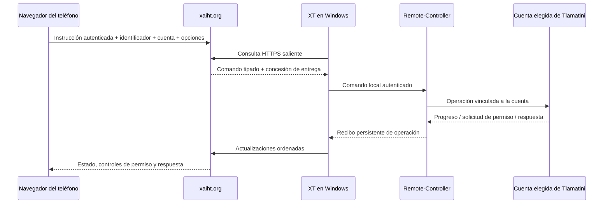

<!-- Tlamatini — Creada por Angela López Mendoza · @angelahack1 -->
# Instrucciones desde el sitio: cuentas, permisos y comportamiento verificado

Documentación revisada el **23 de noviembre de 2026**, sin cambiar las versiones.
Es una actualización de comportamiento y evidencia, no el anuncio de otra versión.

## Recorrido completo



La conexión del sitio no expone el servidor web local de la PC, no abre un puerto
entrante del router, no desbloquea Windows ni inicia Tlamatini. Inicia normalmente
la edición deseada y Remote-Controller desde XT. El cliente RC directo conserva
su propio registro de dispositivos y permisos de ciclo de vida; esas funciones
no se añaden a la página del sitio.

## Preparación y uso diario

1. Abre Tlamatini e inicia sesión con el usuario local deseado. En **Paneles →
   Tlachihuani · Remote-Controller**, habilita esa cuenta con su contraseña actual.
2. Inicia **Remote-Controller** en XT. Conecta XT con la computadora registrada en
   **xaiht.org → Tlamatini-RC**. Conserva una conexión que ya funciona; actualizar
   la página no exige sustituir la clave de la computadora.
3. En **XT → Services → xaiht.org → Accounts…**, marca la cuenta exacta que esté
   lista y guarda el acceso. Nombres iguales en inglés/español o registros
   anteriores no representan la misma identidad. Comprueba edición y disponibilidad;
   no autorices todas las filas de nombre parecido.
4. En el teléfono selecciona la computadora, actualiza las cuentas y elige la
   cuenta lista en **Habla con Tlamatini**. Envía una instrucción y sigue su estado.
5. Mantén abiertos XT, Remote-Controller y la instancia elegida de Tlamatini.
   Al reconectar, consulta la solicitud existente antes de volver a enviarla.

El sitio concede conversación y consulta de estado únicamente a las vinculaciones
autorizadas. Una conversación local y una remota no ejecutan simultáneamente el
modelo de la misma cuenta. Cambiar de cuenta cambia el propietario de la solicitud;
no cambia su modelo ni sus permisos. El sitio no elige otro modelo remoto.

## Qué significa Ask Execs

**Pedir permiso antes de acciones protegidas** es la etiqueta corregida en el
código fuente. Una página publicada anteriormente puede mostrar **Pedir permiso
antes de ejecutar herramientas**. Ambas usan `ask_execs_enabled`: ninguna promete
pedir autorización para todas las herramientas. El modificador requiere Multi-Turn.

La política existente solicita permiso para determinados ejecutores de comandos,
operaciones destructivas o de sobrescritura y ciertas operaciones de red.
**Monitor Netstat y Netstat directo están exentos por ser consultas de solo
lectura**. También hay excepciones deliberadas para escritorio/hardware y
mensajería. No deduzcas la política por el nombre de una herramienta ni añadas
confirmaciones a operaciones exentas como parte de una traducción. Inglés y
español conservan la misma política.

Cuando una acción solicita permiso, revisa la herramienta y sus argumentos.
**Continuar** autoriza esa solicitud pendiente exacta. **Denegar** la rechaza.
Ver el diálogo no demuestra que se haya probado la denegación. **Cancelar
instrucción** solicita cancelación cooperativa: espera un resultado terminal
observado. Cancelar o revocar no deshace acciones que ya terminaron.

## Entrega, respuestas y privacidad

- Los diagnósticos usan `xaiht.tlamatini-rc.message/1` y son inertes aunque su tipo
  sea `command`. Las solicitudes ejecutables usan el esquema cerrado separado
  `xaiht.tlamatini-rc.command/1`.
- Un reintento conserva el identificador. Reutilizarlo con contenido u opciones
  diferentes se rechaza. Recargar consulta solicitudes y respuestas existentes;
  no vuelve a enviarlas. Entrega, aceptación y finalización son estados distintos.
- Una respuesta larga puede mostrar una vista previa. **Obtener respuesta completa**
  usa un permiso firmado vinculado a la cuenta y fragmentos verificados. El contenido
  ausente o caducado se indica como error. El HTML recibido no se ejecuta.
- XT y el sitio se comunican por HTTPS autenticado. El sitio procesa y conserva
  instrucciones y respuestas: **no es cifrado de extremo a extremo ni poscuántico**.
  XT excluye esos cuerpos de su registro de diagnóstico; eso no significa que no
  existan en la base de datos del sitio o en el historial de Tlamatini.
- Retira localmente el permiso de la cuenta para revocar el acceso. Desconectar XT
  interrumpe el transporte; no implica que una operación ya aceptada se detuvo.
- Esta interfaz del teléfono envía texto y no captura su micrófono. Los controles
  de voz del espacio de trabajo independiente actúan sobre la computadora anfitriona.

## Evidencia y comprobaciones pendientes

| Evidencia del 23 de noviembre | Resultado y alcance |
| --- | --- |
| MySQL 8.4.13 real y aislado | 7/7 pruebas transaccionales; esquema eliminado y servidor detenido |
| Integración de código fuente | 76/76 comprobaciones; una respuesta real del modelo por edición; permisos/cancelación y respuesta larga identificados como casos deterministas |
| Regresiones existentes del adaptador | Inglés 309; español 311; no certifican instaladores recién compilados |
| Actualización nativa | 676 archivos de Tray/RCServer verificados; se conservaron identidades, configuración y estado |
| Navegador de producción | 30/30 comprobaciones anónimas a 390px/320px en ambos idiomas; no son pruebas de cuenta autenticada ni de teléfono |
| Teléfono físico, cuenta inglesa instalada | Angela confirmó instrucción/respuesta y persistencia tras recargar la conversación |
| Instrucción real con Executer | Angela confirmó que apareció la solicitud de autorización |
| Denegación y cancelación desde el teléfono | No se completaron antes de detener las pruebas; no declararlas aprobadas |

La instrucción de Netstat llegó al motor instalado con Ask Execs activado y el
gestor de permisos registrado; su excepción explica la ausencia del diálogo.
La etiqueta corregida pasó TypeScript, lint específico, 25 regresiones de
transporte/respuestas y la generación de recursos de producción. Su compilación
candidata en la nube terminó, pero **no se desplegó**. El texto fuente y la última
página publicada son distintos.

Una revisión posterior detectó una posible diferencia al clasificar alias de
herramientas. Se guardaron pruebas del ejecutor, pero no se ejecutaron ni se
modificó el motor antes de detener el trabajo. Resuelve ese hallazgo y completa
denegación sin ejecución, cancelación, reconexión y aislamiento por cuenta/edición
antes de certificar una publicación coordinada. Guardar una prueba no equivale
a aprobarla.

El registro detallado está en `docs/verification/2026-11-23-hosted-prompts.md`
del repositorio Tlachihuani. Esta revisión documental no reinicia aplicaciones,
reanuda pruebas funcionales, despliega, hace commits, crea etiquetas, hace push
ni cambia versiones.

## Contenido compartido para PDF y PPTX

El bloque siguiente conserva el contenido estructurado del capítulo, sin modificar los generadores ni el código de ejecución. Al regenerar el dossier, carga este JSON como un `Chapter` y sus `Section`, y extiende las secciones del capítulo `architecture` después de `build_chapters(facts)`. Mantener los nueve capítulos originales conserva el diseño de la diapositiva de contenido. Genera PDF y PPTX con el mismo contenido; vuelve a verificar el árbol, los límites y todas las páginas/diapositivas. Esta revisión conserva 1.97.0. El atlas conserva su inventario fechado y añade un suplemento remoto identificado.

<details>
<summary>PDF / PPTX</summary>

```json dossier-chapter
{
  "key": "hosted-prompts",
  "numeral": "RC",
  "title": "Conversaciones remotas desde xaiht.org",
  "tagline": "Tu cuenta local, una ruta remota explícita.",
  "accent": "jade",
  "sections": [
    {
      "key": "hosted-route",
      "kicker": "REMOTE-CONTROLLER",
      "title": "Del teléfono a su motor local",
      "lede": "xaiht.org transporta instrucciones y respuestas reales de una cuenta lista y autorizada explícitamente.",
      "points": [
        [
          "Teléfono",
          "Inicia sesión, elige la computadora y la cuenta exacta; envía una instrucción con sus opciones."
        ],
        [
          "XT",
          "Consulta el sitio mediante HTTPS saliente. No necesita abrir un puerto entrante del enrutador."
        ],
        [
          "Remote-Controller",
          "Autoriza la vinculación local y entrega la operación al motor existente de Tlamatini."
        ],
        [
          "Respuesta",
          "El progreso, los permisos y el resultado regresan a la misma solicitud y a su propietario."
        ]
      ]
    },
    {
      "key": "hosted-setup",
      "kicker": "REMOTE-CONTROLLER",
      "title": "Inicia localmente. Elige la cuenta remota.",
      "lede": "El sitio no inicia Tlamatini, no desbloquea Windows ni captura audio del teléfono.",
      "points": [
        [
          "En la computadora",
          "Abre la edición deseada, inicia sesión y habilita su cuenta de Remote-Controller."
        ],
        [
          "En XT",
          "Inicia Remote-Controller. En Services → xaiht.org → Accounts, autoriza la cuenta lista."
        ],
        [
          "En el teléfono",
          "Elige la computadora registrada y la cuenta autorizada. Recargar conserva recibos y respuestas."
        ],
        [
          "Conserva la identidad",
          "Un mismo nombre entre ediciones o registros antiguos no identifica la misma cuenta. No autorices duplicados a ciegas."
        ]
      ]
    },
    {
      "key": "hosted-approval",
      "kicker": "REMOTE-CONTROLLER",
      "title": "Pedir permiso antes de acciones protegidas",
      "lede": "Ask Execs es selectivo: Monitor Netstat es una excepción intencional de solo lectura.",
      "points": [
        [
          "Política existente",
          "Determinados ejecutores, acciones destructivas y operaciones de red pueden pedir permiso. También hay excepciones de escritorio, hardware y mensajería."
        ],
        [
          "Decisión",
          "Continuar autoriza la solicitud pendiente exacta. Denegar la rechaza. Cancelar es cooperativo y no deshace acciones terminadas."
        ],
        [
          "Evidencia del teléfono",
          "Executer mostró una solicitud de autorización en la cuenta inglesa instalada. No se comprobó la denegación sin ejecución antes de detener las pruebas."
        ],
        [
          "Código y despliegue",
          "La etiqueta aclarada pasó comprobaciones y su candidata se compiló en la nube; esa candidata no se desplegó."
        ]
      ]
    },
    {
      "key": "hosted-delivery",
      "kicker": "REMOTE-CONTROLLER",
      "title": "Un recibo no significa una operación terminada",
      "lede": "Comandos tipados, reintentos idénticos y fragmentos ligados a la cuenta mantienen explícita la propiedad.",
      "points": [
        [
          "Mensajes separados",
          "Los diagnósticos siguen siendo inertes. La ejecución usa el contrato separado xaiht.tlamatini-rc.command/1."
        ],
        [
          "Reintento seguro",
          "Conserva el ID, contenido y opciones. Consulta una operación desconocida antes de enviar otra."
        ],
        [
          "Respuestas largas",
          "Recupera el resultado con su permiso firmado por cuenta y verifica orden y hash. La ausencia de contenido es un error."
        ],
        [
          "Revocación",
          "Retirar acceso impide autorizar la cuenta. Desconectar el transporte no demuestra que el trabajo aceptado se detuvo."
        ]
      ]
    },
    {
      "key": "hosted-privacy",
      "kicker": "REMOTE-CONTROLLER",
      "title": "HTTPS protege el transporte; el sitio ve el contenido",
      "lede": "Esta ruta del sitio no tiene cifrado de extremo a extremo ni poscuántico.",
      "points": [
        [
          "Sitio",
          "Procesa y guarda instrucciones y respuestas en su base de datos."
        ],
        [
          "Aplicación local",
          "Usa el modelo, historial y permisos de la cuenta elegida; no selecciona otro modelo remoto."
        ],
        [
          "Diagnóstico",
          "XT excluye los cuerpos de instrucciones y respuestas de su registro. El historial y los registros de Tlamatini son independientes."
        ],
        [
          "Límite de voz",
          "Talker y Whisperer conservan sus capacidades en la computadora. Esta integración del sitio transmite texto, no el micrófono del teléfono."
        ]
      ]
    },
    {
      "key": "hosted-evidence",
      "kicker": "REMOTE-CONTROLLER",
      "title": "Resultados verificados y aceptación pendiente",
      "lede": "Evidencia del 23 de noviembre de 2026; los números de versión existentes no cambian.",
      "points": [
        [
          "Datos y código",
          "MySQL real aislado: 7/7. Integración: 76/76, con una respuesta real del modelo por edición y casos deterministas identificados."
        ],
        [
          "Despliegue",
          "676 archivos nativos Tray/RCServer verificados; comprobaciones anónimas del sitio 30/30 a 390px y 320px en ambos idiomas."
        ],
        [
          "Teléfono físico",
          "Angela confirmó instrucción/respuesta inglesa, recarga de la misma cuenta y aparición de una solicitud de permiso."
        ],
        [
          "Pendiente",
          "Denegación sin ejecución, cancelación, reconexión y aislamiento por edición. Los casos guardados de alias no se ejecutaron ni se corrigieron."
        ]
      ]
    }
  ]
}
```

</details>
